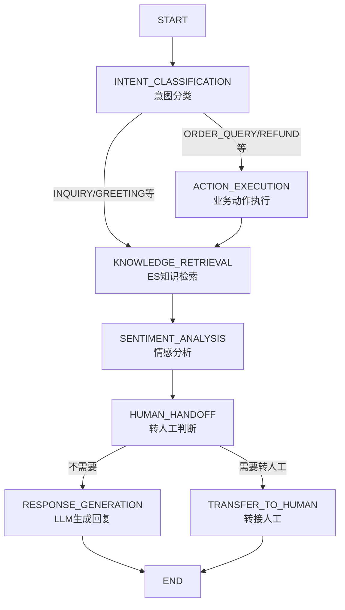

# CommonAgent - 通用智能客服平台

基于 **LangGraph** 工作流的多租户智能客服 Agent 系统，适用于电商、金融、医疗、教育等不同行业。

## 🏗️ 技术架构

```
┌─────────────────────────────────────────────────────────┐
│                    Frontend (Vue 3)                      │
│  ┌──────────┐  ┌──────────┐  ┌────────────────────┐    │
│  │ 聊天界面  │  │ 管理后台  │  │ 知识库/租户管理    │    │
│  └──────────┘  └──────────┘  └────────────────────┘    │
├─────────────────────────────────────────────────────────┤
│                 Backend (Spring Boot 3)                  │
│  ┌──────────────────────────────────────────────────┐   │
│  │           LangGraph Agent 工作流引擎               │   │
│  │  ┌─────────┐  ┌──────────┐  ┌──────────────┐    │   │
│  │  │意图分类 │──▶│动作执行  │──▶│ 知识检索(ES) │    │   │
│  │  └─────────┘  └──────────┘  └──────┬───────┘    │   │
│  │  ┌──────────────┐  ┌──────────────▼────────┐    │   │
│  │  │ 响应生成(LLM)│◀─│转人工判断 (条件边)    │    │   │
│  │  └──────────────┘  └───────────────────────┘    │   │
│  └──────────────────────────────────────────────────┘   │
├─────────────────────────────────────────────────────────┤
│              Data Layer                                  │
│  ┌──────────┐  ┌──────────────┐  ┌──────────┐         │
│  │  MySQL   │  │Elasticsearch │  │  Redis   │         │
│  │(业务数据)│  │ (向量存储)    │  │ (缓存)   │         │
│  └──────────┘  └──────────────┘  └──────────┘         │
└─────────────────────────────────────────────────────────┘
```

## 📁 项目结构

```
CommonAgent/
├── backend/                          # Java Spring Boot 后端
│   ├── src/main/java/com/commonagent/
│   │   ├── agent/                    # LangGraph Agent 核心
│   │   │   ├── AgentWorkflow.java    # 工作流引擎 (图状态机)
│   │   │   ├── WorkflowNode.java     # 节点接口
│   │   │   ├── state/AgentState.java # 工作流状态对象
│   │   │   └── nodes/                # 各工作流节点
│   │   │       ├── IntentClassificationNode.java  # 意图分类
│   │   │       ├── KnowledgeRetrievalNode.java     # ES知识检索
│   │   │       ├── SentimentAnalysisNode.java      # 情感分析
│   │   │       ├── HumanHandoffNode.java           # 转人工判断
│   │   │       ├── ResponseGenerationNode.java     # LLM响应生成
│   │   │       └── ActionExecutionNode.java        # 业务动作执行
│   │   ├── config/                   # 配置 (ES, LLM, WebSocket)
│   │   ├── tenant/                   # 多租户 (上下文、拦截器)
│   │   ├── controller/               # REST API
│   │   ├── service/                  # 业务服务
│   │   ├── repository/               # JPA Repository
│   │   ├── model/                    # JPA 实体
│   │   └── dto/                      # 数据传输对象
│   └── src/main/resources/
│       ├── application.yml
│       └── db/migration/V1__init.sql  # 数据库初始化
├── frontend/                          # Vue 3 前端
│   └── src/
│       ├── views/                     # 页面
│       │   ├── ChatView.vue           # 聊天界面
│       │   ├── AdminView.vue          # 管理后台布局
│       │   ├── Dashboard.vue          # 仪表盘
│       │   ├── TenantManagement.vue   # 租户管理
│       │   └── KnowledgeManagement.vue # 知识库管理
│       ├── stores/                    # Pinia 状态管理
│       ├── api/                       # API 封装
│       └── router/                    # 路由
└── docker-compose.yml                 # 一键部署
```

## 🚀 快速启动

### 前置条件

- JDK 17+
- Node.js 20+
- Docker & Docker Compose (推荐)
- MySQL 8.0+, Elasticsearch 8.x, Redis 7.x

### 方式一: Docker Compose 一键启动

```bash
# 设置 LLM API Key (OpenAI 兼容)
export LLM_API_KEY=sk-xxxxx
export LLM_BASE_URL=https://api.openai.com/v1

# 启动所有服务
docker-compose up -d

# 查看日志
docker-compose logs -f backend
```

访问: http://localhost:3000

### 方式二: 本地开发

**1. 启动基础设施**

```bash
docker-compose up -d mysql elasticsearch redis
```

**2. 启动后端**

```bash
cd backend
# 设置环境变量
export MYSQL_PASSWORD=root
export LLM_API_KEY=sk-xxxxx

# 编译运行
mvn spring-boot:run
```

后端 API: http://localhost:8080

**3. 启动前端**

```bash
cd frontend
npm install
npm run dev
```

前端: http://localhost:3000

## 🔧 核心功能

### 1. LangGraph Agent 工作流



### 2. 多租户支持

- **数据隔离**: 所有表包含 `tenant_id` 列，ES 索引按租户分离 (`{prefix}_{tenantId}`)
- **请求路由**: 通过 `X-Tenant-Id` 请求头识别租户
- **配置隔离**: 每个租户可独立配置:
  - LLM 模型和参数
  - 自定义 Prompt 模板
  - 行业意图体系 (电商/金融/医疗等)
  - 欢迎语和品牌信息

### 3. 知识库管理

- **向量存储**: Elasticsearch dense_vector 存储文本嵌入
- **混合检索**: kNN 向量相似度 + IK 中文分词关键词匹配
- **内容管理**: 支持手动添加、批量导入 (JSON/CSV)
- **引用统计**: 追踪知识条目被引用次数

### 4. 智能对话

- **意图识别**: LLM 驱动的多行业意图分类
- **情感分析**: 实时监控用户情绪，触发升级策略
- **智能转人工**: 负面情绪/低置信度/超时等多条件自动转接
- **业务动作**: 可扩展的订单查询、退款等业务系统对接

## 📡 API 接口

### 聊天接口

| 方法 | 路径 | 说明 |
|------|------|------|
| POST | `/api/chat/send` | 发送消息 |
| GET | `/api/chat/history/{conversationId}` | 获取会话历史 |
| GET | `/api/chat/conversations` | 获取用户会话列表 |

### 知识库接口

| 方法 | 路径 | 说明 | 请求头 |
|------|------|------|--------|
| POST | `/api/knowledge` | 添加知识 | X-Tenant-Id |
| GET | `/api/knowledge` | 查询知识列表 | X-Tenant-Id |
| DELETE | `/api/knowledge/{id}` | 删除知识 | X-Tenant-Id |
| POST | `/api/knowledge/batch` | 批量导入 | X-Tenant-Id |

### 租户管理接口

| 方法 | 路径 | 说明 |
|------|------|------|
| POST | `/api/tenants/register` | 注册租户 |
| GET | `/api/tenants` | 获取租户列表 |
| PUT | `/api/tenants/{id}` | 更新租户 |
| DELETE | `/api/tenants/{id}` | 停用租户 |

## 🎯 行业适配

系统通过 `industry` 字段适配不同行业:

| 行业 | industry 值 | 特殊配置 |
|------|-------------|----------|
| 通用 | `general` | 默认意图体系和 Prompt |
| 电商 | `ecommerce` | 订单/退款/商品专用意图 + 电商 Prompt |
| 金融 | `finance` | 账户/交易/合规审核 + 合规 Prompt |
| 医疗 | `healthcare` | 预约/处方/医保 + 医疗合规 Prompt |
| 教育 | `education` | 课程/考试/证书 + 教育 Prompt |

## 🔐 安全配置

```yaml
# 生产环境建议
- 启用 ES 身份认证 (xpack.security.enabled=true)
- 配置 Redis 密码
- 使用 HTTPS + API 网关
- LLM API Key 使用密钥管理服务 (Vault/K8s Secret)
- 添加接口限流 (Rate Limiting)
```

## 📄 License

MIT
